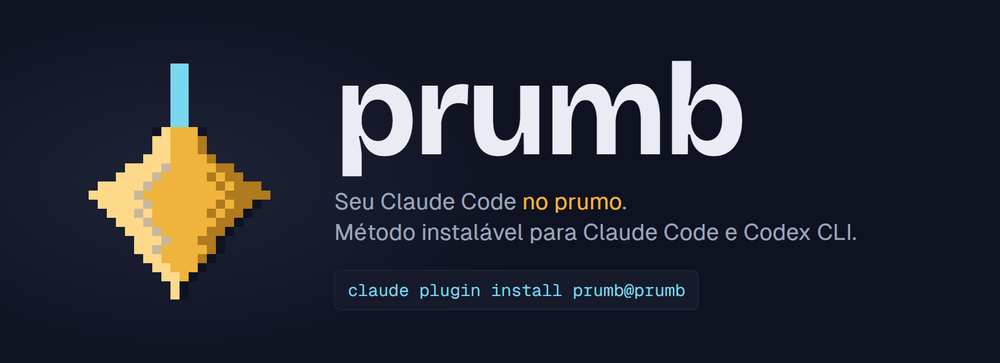
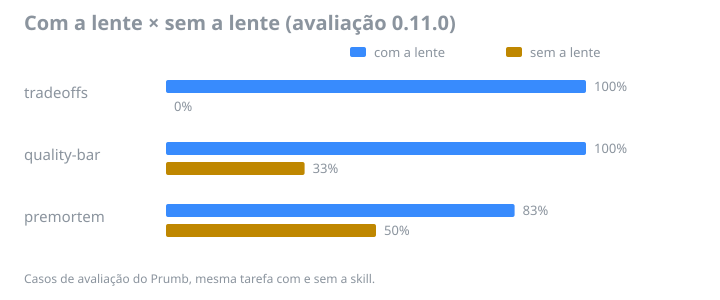

<p align="center"></p>

# Prumb Lite

Três lentes do Prumb e uma trava de segurança, grátis, para Claude Code e Codex.

[](LICENSE)


## O que é o Prumb

Um setup para Claude Code e Codex que muda como o assistente trabalha: planeja antes, mede antes de dizer pronto, não apaga trabalho.  
Não é uma pasta de prompts: são lentes que entram sozinhas na hora certa, travas que impedem o erro caro e um painel para ligar e desligar tudo.  
O Lite é uma amostra. O completo está em [prumb.com.br](https://prumb.com.br).

## Instalar

### Claude Code

No Claude Code, execute:

```text
/plugin marketplace add prumb/prumb-lite
```

```text
/plugin install prumb-lite@prumb-lite
```

Depois, feche e abra o Claude Code.

### Codex

```sh
npx skills add prumb/prumb-lite
```

No Codex entram as três lentes; a trava de git é do Claude Code.

## O que vem

| Lente | O que faz | Quando entra |
| --- | --- | --- |
| [tradeoffs](skills/tradeoffs/SKILL.md) | Expõe ganhos, perdas e custo de mudar. | Ao escolher entre alternativas técnicas ou de produto. |
| [quality-bar](skills/quality-bar/SKILL.md) | Define provas de que a entrega está pronta. | Antes de concluir uma tarefa, revisar uma entrega ou escrever a condição de parada de /goal. |
| [premortem](skills/premortem/SKILL.md) | Antecipa falhas e inclui prevenção no plano. | Antes de construir, publicar ou tomar decisões de arquitetura. |
| Trava de git | Bloqueia descarte de trabalho não salvo e exclusão de stash existente. | Antes de comandos de descarte no Bash ou PowerShell do Claude Code. |

A trava permite comandos comuns, como `git status` e `git restore --staged`. Com a árvore limpa, permite descartar arquivos. Se não conseguir consultar o Git, deixa o comando passar, como no Prumb completo.

## Funciona?



Nos casos de avaliação do Prumb 0.11.0, as três lentes melhoraram o resultado da mesma tarefa; os percentuais descrevem esses casos, sem garantir resultados em outras tarefas.

## Amostra × Prumb completo

| Recurso | Amostra | Prumb completo |
| --- | --- | --- |
| Lentes | 3 | Lista completa abaixo |
| Trava de git | Sim | Sim |
| Outras travas (shell, VPS, higiene) | Não | Sim |
| Ajudantes (scout, researcher, auditor) | Não | Sim |
| Comandos /resume e /wrap-up | Não | Sim |
| Nome e postura do seu agente | Não | Sim |
| Pacotes Design, Negócio, Codex | Não | Sim |
| Painel para conferir, ajustar e atualizar | Não | Sim |
| Atualizações | Comunidade | 12 meses inclusos |
| Preço | Grátis | R$ 197 único |

[**Conhecer o Prumb completo**](https://prumb.com.br)

## Todas as lentes do Prumb completo

### Base

- **architect**: Organiza o projeto, escolhe a estrutura e registra decisões técnicas.
- **critique**: Questiona uma proposta e procura falhas antes da decisão.
- **debug-sistematico**: Investiga a causa de um erro antes de tentar corrigi-lo.
- **entrega-cliente**: Define posse, custos, acessos e saída na entrega ao cliente.
- **higiene-segredo**: Previne vazamentos de senhas, chaves e dados sensíveis.
- **hygiene**: Evita código desnecessário e limpa o que a mudança deixou para trás.
- **memoria**: Consulta o histórico relevante antes de começar uma tarefa.
- **premortem** (no Lite): Antecipa formas de falhar e inclui prevenção no plano.
- **prod-workflow**: Cria automações e integra serviços com n8n.
- **quality-bar** (no Lite): Exige provas verificáveis antes de declarar uma entrega pronta.
- **service-health**: Confere disponibilidade, certificados e dependências dos serviços.
- **tradeoffs** (no Lite): Expõe ganhos, perdas e custo de mudar cada decisão.
- **triagem-repo**: Avalia se uma ferramenta deve ser adotada, estudada ou descartada.
- **vps-safety**: Protege operações em servidores e infraestrutura de produção.

### Design

- **design-gate**: Revisa interfaces para evitar escolhas visuais genéricas.
- **design-memory**: Preserva as decisões de marca e aparência de cada projeto.
- **prod-lp**: Produz páginas de captura, pré-lançamento e vendas.
- **rastreabilidade**: Mede visitas, ações e conversões em páginas e fluxos.

### Negócio

- **copy**: Escreve títulos, chamadas e textos que ajudam a vender.
- **finance**: Calcula custos, preços, margens e retorno para orientar decisões.
- **growth**: Planeja e executa ações de divulgação e crescimento.
- **humanizer**: Revisa textos para retirar padrões de escrita artificial.
- **strategist**: Avalia o negócio e transforma escolhas de estratégia em ação.

### Codex

- **codex-exec**: Divide a execução entre Claude Code e Codex conforme o tamanho da tarefa.

### Huashu

- **huashu-design**: Cria protótipos, apresentações, animações e vídeos com narração.

## Ajudantes do Prumb completo

Agentes que o assistente chama sozinho para gastar menos e errar menos:

- **scout**: Faz a coleta mecânica (contar, listar, ler log) num modelo mais barato.
- **researcher**: Explora código e documentação a fundo sem lotar a conversa principal.
- **auditor**: Revisa mudança de alto risco (banco, login, cobrança, publicação) antes de aplicar.

## Redes

[X](https://x.com/PrumbOficial) · [Instagram](https://www.instagram.com/prumb.oficial/) · [Threads](https://www.threads.com/@prumb.oficial)

---

Prumb · criado por Gustavo Muci. Licença MIT.
